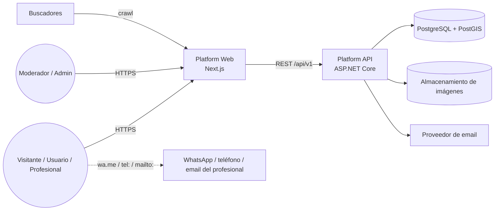
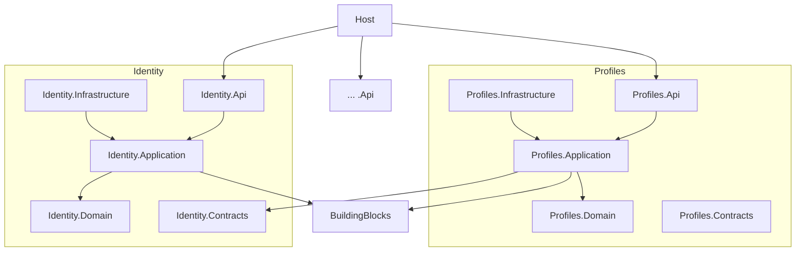

# Arquitectura

Etapa 0 (AGENTS.md §28, puntos 10 y 11). Base: AGENTS.md §5, §10, §23. Decisiones en `docs/decisions/`.

## Contexto (C4 nivel 1)



## Contenedores (C4 nivel 2)

| Contenedor | Tecnología | Responsabilidad |
|---|---|---|
| Web | Next.js App Router, TypeScript strict, Tailwind, shadcn/ui | SSR de páginas públicas (SEO), UI autenticada, BFF: mantiene la sesión en cookie httpOnly y llama a la API del lado del servidor |
| API | ASP.NET Core (.NET 10), modular monolith | Todos los módulos, un solo proceso y un solo deploy |
| Worker (mismo proceso en MVP) | `BackgroundService` en el Host | Despacho del outbox, envío de emails, expiración de solicitudes |
| BD | PostgreSQL + PostGIS + `unaccent` + `pg_trgm` | Un schema por módulo |
| Storage | Volumen local en dev; S3 compatible en prod (D10) | Imágenes procesadas |

## Modular monolith



### Proyectos por módulo

```
backend/src/Modules/<Module>/
├── Platform.<Module>.Domain/          entidades, VOs, eventos de dominio, errores
├── Platform.<Module>.Application/     commands, queries, handlers, validators, puertos
├── Platform.<Module>.Infrastructure/  DbContext, configuraciones EF, repositorios, adaptadores
├── Platform.<Module>.Api/             endpoints (Minimal APIs agrupadas), request/response
└── Platform.<Module>.Contracts/       interfaces públicas, DTOs, eventos de integración
```

Módulos chicos (Favorites, Geography) pueden empezar con menos proyectos si el test de arquitectura igual verifica la dirección de dependencias. Se decide al implementarlos.

### BuildingBlocks

```
backend/src/BuildingBlocks/
├── Platform.BuildingBlocks.Domain/          Entity, AggregateRoot, DomainEvent, Result/Error, ids tipados
├── Platform.BuildingBlocks.Application/     ICommandHandler, IQueryHandler, IUnitOfWork, paginación, IClock
├── Platform.BuildingBlocks.Infrastructure/  PlatformDbContext, convenciones EF (UTC, snake_case), outbox, provider Npgsql, dispatcher in-process
└── Platform.BuildingBlocks.Api/             Problem Details, filtros de validación, rate limiting, auth helpers
```

En #2 los cuatro proyectos contienen solo un `AssemblyMarker` público y las referencias de su capa; los tipos listados se agregan en los issues de dominio. Sin lógica de negocio. Si algo de dominio aparece acá, va mal.

### Host

`backend/src/Host/Platform.Host/`: `Program.cs`, composición con `ElRoso.Commons` (`AddX`/`UseX`: configuración, Serilog, forwarded headers, exception handler, health checks), configuración, middleware. En #4 registra `IdentityDbContext` y exige `ConnectionStrings__Default` (falla cerrado); no llama a `Migrate()`. Expone `/` (info) y `/health`; la composición de módulos (`AddIdentityModule()`, `MapIdentityEndpoints()`) se agrega cuando existan endpoints.

### Tests

```
backend/tests/
├── UnitTests/Platform.<Module>.UnitTests/           dominio y handlers con dobles
├── IntegrationTests/Platform.<Module>.IntegrationTests/  Postgres real con Testcontainers
├── ArchitectureTests/Platform.ArchitectureTests/    NetArchTest: capas y límites entre módulos
└── FunctionalTests/Platform.FunctionalTests/        WebApplicationFactory: HTTP de punta a punta
```

## Reglas de dependencia (verificadas por tests)

1. `*.Domain` → solo `BuildingBlocks.Domain`.
2. `*.Application` → su `Domain`, `BuildingBlocks.Application` y `*.Contracts` de otros módulos.
3. `*.Infrastructure` → su `Application` y `Domain`, `BuildingBlocks.Infrastructure`.
4. `*.Api` → su `Application` y `BuildingBlocks.Api`. Nunca `Infrastructure` ni `DbContext`.
5. Un módulo nunca referencia `Domain`, `Application`, `Infrastructure` ni `Api` de otro.
6. `*.Contracts` no referencia nada de su módulo salvo `BuildingBlocks.Domain` para ids.
7. Sin dependencias circulares entre proyectos.

## Casos de uso: handlers propios

Sin MediatR (pago) ni otra librería de mediator (ADR-0004).

```csharp
public interface ICommandHandler<in TCommand, TResult> { Task<Result<TResult>> Handle(TCommand command, CancellationToken ct); }
public interface IQueryHandler<in TQuery, TResult>   { Task<TResult> Handle(TQuery query, CancellationToken ct); }
```

- Registro por escaneo de ensamblado del módulo.
- Endpoint → valida request (FluentValidation, Apache 2.0) → handler → `Result` → Problem Details.
- Cross-cutting (transacción, logging) con decoradores registrados en DI, no con pipeline mágico.

## Comunicación entre módulos

- **Consulta sincrónica**: interfaz `*.Contracts` implementada por el módulo dueño, resuelta por DI.
- **Eventos de integración**: el handler guarda el agregado y el evento en la tabla `outbox` de su schema en la misma transacción. Un worker despacha in-process a los handlers suscriptos de otros módulos; cada consumidor registra `inbox` para idempotencia (ADR-0005).
- Sin broker externo en el MVP. El contrato de eventos permite sumar uno después sin cambiar productores.

## Búsqueda

- Discovery mantiene `discovery.search_document` (desnormalizado: nombre, descripción, especialidades, sinónimos, localidad, geometría del área, completitud, fechas).
- Columna `tsvector` con configuración `spanish` + `unaccent`; índice GIN.
- `pg_trgm` para tolerancia a errores de tipeo en nombres de especialidades y localidades.
- Distancia con PostGIS `geography` + índice GiST; filtro `ST_DWithin`.
- Interpretación de consulta (BR-050) en Application de Discovery, con diccionarios cargados desde Catalog y Geography y cacheados en memoria con invalidación por evento.
- Ranking (BR-055) calculado en SQL con pesos configurables; documentado y testeado con casos fijos.

## Frontend

```
frontend/src/
├── app/                      rutas App Router; (public)/ SSR/SSG para SEO, (app)/ autenticado, (admin)/
├── features/<feature>/       componentes, hooks, schemas Zod y llamadas propias de la feature
├── components/ui/            primitivas shadcn/ui
├── components/               componentes compartidos con uso real en 2+ features
├── lib/                      cliente API tipado, sesión, utilidades
├── services/                 acceso a API del lado servidor (BFF)
├── schemas/                  schemas Zod compartidos
└── types/                    tipos generados del contrato OpenAPI
```

- Server Components por defecto; Client Components solo con interacción.
- Tipos de la API generados desde el OpenAPI del backend (herramienta OSS a elegir en Etapa 1).
- Sesión: la Web guarda los tokens en cookie httpOnly, Secure, SameSite=Lax; el browser nunca ve el access token (ADR-0006).
- Reglas de dominio no se replican en React: el front valida forma (Zod) y muestra errores del backend.

## Observabilidad

Serilog con salida JSON, correlation id por request propagado a eventos, OpenTelemetry (traces + métricas) con exportador OTLP, health checks `/health/live` y `/health/ready` (BD). Nada sensible en logs (AGENTS.md §19).

## Escalado

El MVP corre en una réplica. Lo que asume una réplica queda listado para revisar antes de escalar: cache de diccionarios de búsqueda, worker de outbox, rate limiter en memoria.
