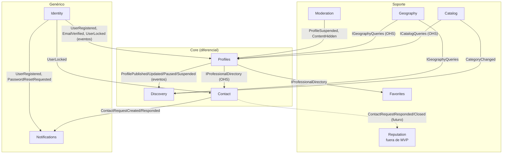

# Bounded Contexts

Etapa 0 (AGENTS.md §28, punto 6). Base: AGENTS.md §6.

## Mapa de contextos

Relaciones: todos los módulos son del mismo equipo y repo, así que la relación por defecto es **Customer/Supplier** con **Open Host Service** (interfaz pública del módulo) y **Published Language** (DTOs y eventos de integración versionados). No hay Shared Kernel salvo `BuildingBlocks` (tipos técnicos, sin dominio).

## Contrato por módulo

Cada módulo expone **solo** un proyecto `*.Contracts` con interfaces de consulta, DTOs y eventos de integración. Nadie referencia `Domain`, `Application` ni `Infrastructure` de otro módulo.

| Módulo | Responsabilidad | Publica (eventos ⇄) | Expone (consultas) | Consume |
|---|---|---|---|---|
| **Identity** | Cuentas, credenciales, sesiones, roles | `UserRegistered`, `EmailVerified`, `UserLocked`, `UserUnlocked`, `PasswordResetRequested`, `UserDeleted` | `ICurrentUser`, `IUserDirectory` (id → nombre visible, estado) | — |
| **Profiles** | UserProfile, ProfessionalProfile, portfolio, preferencias de contacto | `ProfessionalProfilePublished`, `…Updated`, `…Paused`, `…Suspended`, `…Reinstated` | `IProfessionalDirectory` (id/slug → resumen público, estado, canales publicados) | Identity, Catalog, Geography, Moderation |
| **Catalog** | Categorías jerárquicas, profesiones, especialidades, sinónimos | `CategoryChanged` | `ICatalogQueries` (árbol, búsqueda por slug, sinónimos) | — |
| **Geography** | Provincias, localidades, códigos postales, centroides, áreas de servicio | — (datos casi estáticos) | `IGeographyQueries` (resolver texto → localidad, distancia, vecinos en radio) | — |
| **Discovery** | Índice de búsqueda, interpretación de consulta, ranking, páginas SEO | — | `ISearchQueries` | Profiles, Catalog, Geography |
| **Contact** | Solicitudes internas, estados, antiabuso, canales públicos | `ContactRequestCreated`, `…Responded`, `…Closed` | `IContactQueries` (mis solicitudes) | Identity, Profiles |
| **Favorites** | Profesionales guardados | — | `IFavoriteQueries` | Profiles |
| **Moderation** | Reportes, casos, acciones, auditoría de moderación | `ProfileSuspended`, `ProfileSuspensionLifted`, `ContentHidden` | `IModerationQueries` (panel) | Identity, Profiles |
| **Notifications** | Envío de emails transaccionales (MVP) | — | — | Identity, Contact |
| **Reputation** | Valoraciones (fuera de MVP) | `ReviewSubmitted` | — | Contact |

## Qué NO se comparte

| Dato | Dueño | Otros módulos ven |
|---|---|---|
| Email, hash, sesiones | Identity | Solo `UserId` y nombre visible |
| Teléfono y email privados del profesional | Profiles | Solo lo publicado en `PublicContactPreferences` |
| Ubicación exacta | Nadie la guarda salvo necesidad (BR-031) | Localidad o centroide del área |
| Texto de solicitudes | Contact | Notifications recibe solo lo necesario para el email |
| Reportes y motivos | Moderation | Profiles recibe el hecho (`ProfileSuspended`), no el detalle |

## Reglas de comunicación

- Escritura cruzada: siempre por evento de integración, nunca llamando a otro módulo para que guarde.
- Lectura cruzada sincrónica: solo por interfaz `*.Contracts` cuando el caso de uso necesita el dato en el momento (ej. Contact valida que el profesional esté publicado).
- Discovery no consulta Profiles en cada búsqueda: mantiene su propio read model alimentado por eventos.
- Cada evento de integración lleva `EventId`, `OccurredAtUtc`, `Version` y solo ids + datos mínimos.
- Consistencia eventual aceptada entre módulos; dentro de un agregado, consistencia transaccional.
