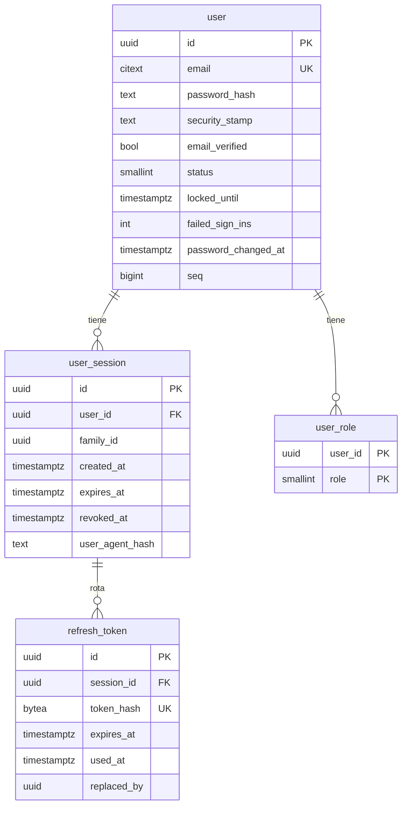
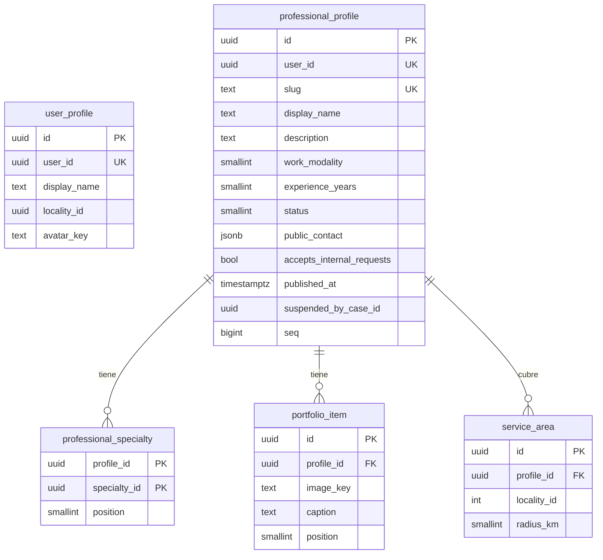

# Base de datos

Etapa 0 (AGENTS.md §28, punto 12). Base: AGENTS.md §8. ADR-0002, ADR-0003.

## Convenciones

- PostgreSQL 17 + PostGIS; extensiones `postgis`, `unaccent`, `pg_trgm`, `citext`.
- Un schema por módulo: `identity`, `profiles`, `catalog`, `geography`, `discovery`, `contact`, `favorites`, `moderation`, `notifications`.
- Un `DbContext` por módulo; cada uno con su historial de migraciones (`__ef_migrations_history` en su schema).
- Nombres `snake_case`. PK `id uuid` (UUID v7, generado en la app: ordenable). Tablas de referencia geográfica usan el id oficial.
- Timestamps `timestamptz` en UTC: `created_at`, `updated_at`. Estado como `smallint` con valores fijos (nunca renumerar).
- FK reales dentro del schema. **Entre schemas no hay FK**: se guarda el id y la consistencia es por eventos.
- Concurrencia optimista con `xmin` en agregados editables.
- Soft delete solo donde hay necesidad funcional (ninguna en el MVP salvo anonimización de usuario).
- `outbox_message` e `inbox_message` en cada schema que publica o consume.

## Modelo por schema

### identity

Además: `email_verification_token`, `password_reset_token` (hash, vence, usado), `audit_log`.

### profiles

`public_contact` guarda solo lo que el profesional decidió publicar (`whatsapp`, `phone`, `email`).

### catalog

`category (id, parent_id, slug, name, level, is_active, position)` con `UNIQUE(parent_id, slug)` y `CHECK(level BETWEEN 1 AND 3)`; `specialty (id, category_id, slug, name, is_active)`; `service_tag (id, specialty_id, term, normalized_term)`.

### geography

`province (id, name, slug)`, `locality (id, province_id, name, slug, centroid geography(Point))`, `postal_code (code, locality_id)`. Datos importados de Georef (D12) por script versionado; ids oficiales.

### discovery

`search_document (profile_id PK, slug, display_name, description, specialty_ids uuid[], category_ids uuid[], terms text, locality_id, province_id, area geography, work_modality, completeness smallint, updated_at, search_vector tsvector)`.

### contact

`contact_request (id, requester_id, professional_profile_id, message, preferred_channel, status, created_at, viewed_at, responded_at, closed_at, cancelled_at, last_activity_at)` + `contact_request_transition` (historial).

### favorites

`favorite (user_id, professional_profile_id, created_at)` PK compuesta.

### moderation

`moderation_case (id, target_type, target_id, status, opened_at, resolved_at)`, `report (id, case_id, reporter_id, reason, detail, created_at)`, `moderation_action (id, case_id, actor_id, action, reason, created_at)`.

### notifications

`email_message (id, template, recipient_hash, status, attempts, created_at, sent_at)`. El email del destinatario se resuelve al enviar; no se guarda el cuerpo.

## Restricciones e índices

| Tabla | Restricción / índice | Tipo | Por qué |
|---|---|---|---|
| `identity.user` | `UNIQUE(email)` | btree (citext) | BR-001 |
| `identity.refresh_token` | `UNIQUE(token_hash)` | btree | Lookup por token |
| `profiles.professional_profile` | `UNIQUE(user_id)` | btree | BR-021 |
| `profiles.professional_profile` | `UNIQUE(slug)` | btree | URL pública |
| `profiles.professional_profile` | `(status, updated_at)` | btree | Listados admin |
| `catalog.service_tag` | `normalized_term` | GIN `gin_trgm_ops` | Match aproximado de sinónimos |
| `geography.locality` | `centroid` | GiST | Cercanía |
| `geography.locality` | `name` | GIN `gin_trgm_ops` | Resolver texto → localidad |
| `discovery.search_document` | `search_vector` | GIN | FTS |
| `discovery.search_document` | `area` | GiST | `ST_DWithin` |
| `discovery.search_document` | `specialty_ids`, `category_ids` | GIN | Filtros |
| `discovery.search_document` | `(locality_id)`, `(province_id)` | btree | Filtros y páginas SEO |
| `contact.contact_request` | `UNIQUE(requester_id, professional_profile_id) WHERE status IN (0,1,2)` | parcial | BR-063 |
| `contact.contact_request` | `(professional_profile_id, status, created_at)` | btree | Bandeja del profesional |
| `contact.contact_request` | `(requester_id, created_at)` | btree | Límite diario BR-064 |
| `moderation.moderation_case` | `UNIQUE(target_type, target_id) WHERE status <> resolved` | parcial | BR-081 |
| `moderation.report` | `UNIQUE(case_id, reporter_id)` | btree | BR-080 |

Checks: largos de texto según VOs, `radius_km BETWEEN 1 AND 200`, `experience_years BETWEEN 0 AND 70`, estados dentro del rango.

## Migraciones

- `dotnet ef migrations add` por `DbContext`; nombre descriptivo.
- Aplicación: comando explícito al deploy (bundle de migraciones), nunca `Migrate()` automático en producción.
- Compatibles con deploy progresivo: primero aditivas (columna nullable, tabla nueva), después código, después limpieza en migración aparte.
- CI verifica que no queden cambios de modelo sin migración.
- Migración destructiva requiere aprobación (AGENTS.md §27.5).

## Datos personales

| Dato | Dónde | Tratamiento |
|---|---|---|
| Email, hash | `identity.user` | Anonimizado al borrar cuenta |
| Teléfono/email publicados | `profiles.professional_profile.public_contact` | Borrado al despublicar si el profesional lo pide; borrado con la cuenta |
| Mensajes de contacto | `contact.contact_request.message` | Retención 12 meses tras cierre (parámetro) |
| IP, user agent | Solo hash en sesiones; logs sin IP completa | Minimización |
