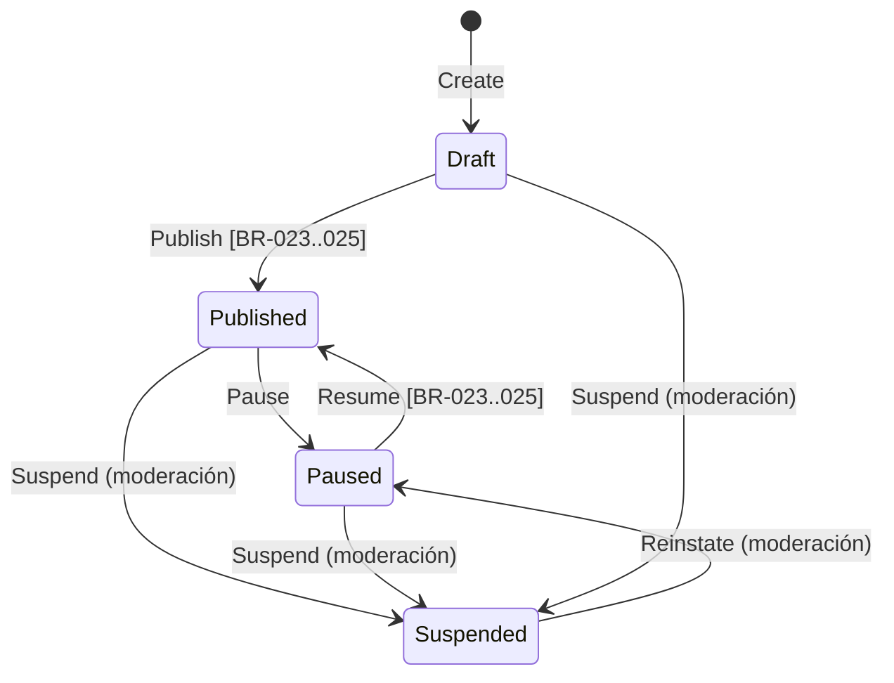
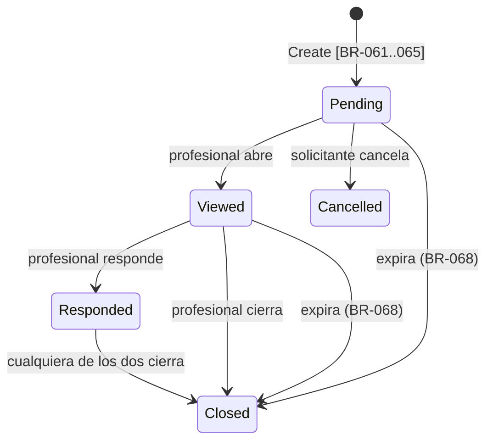

# Modelo de dominio

Etapa 0 (AGENTS.md §28, puntos 7, 8 y 9). Base: AGENTS.md §7.

Las reglas `BR-xxx` son referenciables desde tests (nombre del test o `[Trait("Rule", "BR-023")]`).

## Agregados por módulo

| Módulo | Agregado (raíz) | Entidades internas | Invariante principal |
|---|---|---|---|
| Identity | `User` | `UserSession`, `RefreshToken` | Email único; sesión revocada no se reactiva |
| Profiles | `UserProfile` | — | Uno por `UserId` |
| Profiles | `ProfessionalProfile` | `ProfessionalSpecialty`, `PortfolioItem`, `ServiceArea` | Transiciones de estado y requisitos de publicación |
| Catalog | `Category` | — (jerarquía por `ParentId`) | Sin ciclos; slug único por nivel |
| Catalog | `Specialty` | `ServiceTag` (sinónimos) | Pertenece a una categoría activa |
| Geography | `Locality` | `PostalCode` | Id oficial único; pertenece a una provincia |
| Contact | `ContactRequest` | — | Una abierta por par solicitante–profesional |
| Favorites | `Favorite` | — | Único por usuario–profesional |
| Moderation | `ModerationCase` | `Report`, `ModerationAction` | Un caso abierto por objetivo |

`Province` y `Country` son datos de referencia (no agregados con comportamiento).

## Value Objects

Solo los que validan o encapsulan algo. Todos inmutables (`record`), con factoría que falla con error de dominio.

| VO | Valida | Usado en |
|---|---|---|
| `EmailAddress` | Formato, normalización a minúsculas, largo ≤ 254 | Identity, Profiles (contacto publicado) |
| `PhoneNumber` | E.164, prefijo AR por defecto, solo dígitos | Profiles |
| `PersonName` | 2–80 caracteres, sin solo espacios | Identity, Profiles |
| `ProfessionalDescription` | 30–2000 caracteres, sin URLs ni teléfonos embebidos en el MVP | Profiles |
| `ProfileSlug` | `[a-z0-9-]`, 3–80, único (lo garantiza la BD) | Profiles |
| `GeoCoordinate` | Lat −90..90, Lon −180..180 | Geography, Profiles |
| `ServiceRadius` | 1–200 km | Profiles, Discovery |
| `ExperienceYears` | 0–70 | Profiles |
| `RatingValue` | 1–5 entero (fuera de MVP) | Reputation |

Descartado como VO: `PostalCode` (es entidad de referencia de Geography), `CategoryId` y demás ids (se usan `Guid` tipados con `readonly record struct`).

## Máquinas de estado

### ProfessionalProfile



Un perfil suspendido vuelve a `Paused`, nunca directo a `Published`: el profesional decide republicar.

### ContactRequest



### ModerationCase

`Open` → `InReview` → `Resolved` (con `ModerationAction`: `Dismissed`, `ContentHidden`, `ProfileSuspended`) · `Resolved` → `Reopened` solo por admin.

## Reglas de negocio

### Identity
- **BR-001** Email único por cuenta, comparado normalizado.
- **BR-002** Contraseña: mínimo 10 caracteres, sin reglas de composición, rechazada si figura en lista de contraseñas filtradas (ASVS V2.1).
- **BR-003** El registro responde igual exista o no el email (sin enumeración); si existe, se avisa por email al dueño.
- **BR-004** Una cuenta nueva no está verificada; sin verificar puede navegar y crear borrador, no publicar ni enviar solicitudes.
- **BR-005** El link de verificación es de un solo uso y vence a las 24 h.
- **BR-006** Bloqueo temporal tras 5 intentos fallidos en 15 min por cuenta, y rate limit por IP.
- **BR-007** Refresh token rotativo; reuso de un token rotado revoca toda la familia de sesión.
- **BR-008** La validez de una sesión se decide contra `UserSession`, no contra la existencia de un refresh token.
- **BR-009** El usuario puede ver y revocar sus sesiones.
- **BR-010** Cambio o recuperación de contraseña revoca todas las sesiones.
- **BR-011** Un usuario bloqueado por admin no inicia sesión y sus perfiles quedan suspendidos.

### Profiles
- **BR-020** Un `UserProfile` por usuario, creado con el registro.
- **BR-021** Un `ProfessionalProfile` por usuario en el MVP (D19 en `ROADMAP.md`).
- **BR-022** El borrador se guarda incompleto; no hay campos obligatorios para guardar.
- **BR-023** Publicar exige: nombre visible, descripción válida, al menos una especialidad, modalidad de trabajo (`OnSite`, `Remote`, `Both`), y zona de cobertura si la modalidad incluye `OnSite`.
- **BR-024** Publicar exige email verificado.
- **BR-025** Publicar exige al menos un canal de contacto: un canal público (WhatsApp, teléfono, email) o aceptar solicitudes internas.
- **BR-026** Editar un perfil publicado no puede dejarlo sin cumplir BR-023..025.
- **BR-027** Pausado: no aparece en búsqueda ni recibe solicitudes nuevas; su URL pública muestra "no disponible temporalmente".
- **BR-028** Solo moderación suspende y rehabilita; el profesional no puede publicar un perfil suspendido.
- **BR-029** Portfolio: hasta 20 imágenes, cada una ≤ 5 MB, JPEG/PNG/WebP validado por contenido; EXIF eliminado.
- **BR-030** No se exige portfolio ni foto para publicar.
- **BR-031** Nunca se guarda ni muestra domicilio. Ubicación del profesional = localidad base + radio, o lista de localidades.
- **BR-032** Teléfono y email publicados son explícitos; los de la cuenta no se exponen por defecto.

### Catalog
- **BR-040** Categorías jerárquicas de hasta 3 niveles; sin ciclos.
- **BR-041** Desactivar una categoría no borra especialidades de perfiles: quedan visibles hasta que el profesional edite.
- **BR-042** Sinónimos (`ServiceTag`) asociados a especialidades alimentan la interpretación de búsqueda.

### Discovery
- **BR-050** La consulta natural se interpreta sin IA: normalización (minúsculas, sin acentos, sin stopwords) → match de sinónimos contra Catalog → match de localidad contra Geography → detección de modalidad ("remoto", "a domicilio").
- **BR-051** Si no se reconoce servicio, se hace búsqueda de texto completo sobre nombre, descripción y especialidades.
- **BR-052** Solo perfiles `Published` aparecen en resultados.
- **BR-053** Sin resultados: se sugiere ampliar radio o quitar filtros, nunca resultados vacíos sin guía.
- **BR-054** Paginación obligatoria; tamaño máximo 50.
- **BR-055** Ranking orgánico: relevancia textual + cercanía + completitud del perfil + recencia de actualización. Sin peso por cantidad de valoraciones; sin pagos.
- **BR-056** Páginas indexables solo para combinaciones categoría/provincia/localidad con al menos un resultado; filtros adicionales no generan URLs indexables.

### Contact
- **BR-060** Canales públicos visibles solo si el profesional los publicó.
- **BR-061** Solicitud interna requiere usuario con email verificado.
- **BR-062** No se puede enviar solicitud a uno mismo ni a perfiles no `Published`.
- **BR-063** Una solicitud abierta (`Pending`/`Viewed`/`Responded`) por par solicitante–profesional; reintento devuelve la existente (idempotente).
- **BR-064** Límite de solicitudes nuevas por usuario por día (parámetro, inicial 10).
- **BR-065** Mensaje 10–1000 caracteres.
- **BR-066** Transiciones solo según la máquina de estados; cada cambio registra fecha UTC y actor.
- **BR-067** Pausar el perfil no cierra solicitudes abiertas.
- **BR-068** Solicitudes sin actividad 30 días pasan a `Closed`.

### Favorites
- **BR-070** Un favorito por usuario–profesional; agregar dos veces es idempotente.

### Moderation
- **BR-080** Cualquier usuario autenticado puede reportar; un reporte por usuario por objetivo mientras el caso esté abierto.
- **BR-081** Reportes del mismo objetivo se agrupan en un caso.
- **BR-082** Toda acción de moderación registra motivo, actor y fecha; es auditable.
- **BR-083** Un moderador no modera su propio perfil ni reportes propios.
- **BR-084** Suspender un perfil lo saca de búsqueda de inmediato.

### Administración
- **BR-090** Solo admin asigna o quita roles; no puede quitarse el rol admin a sí mismo si es el último.
- **BR-091** Bloquear un usuario es reversible; borrar cuenta es un flujo aparte con anonimización (Ley 25.326).
- **BR-092** Cambios de parámetros y roles quedan en auditoría.

## Domain Events

Dentro de cada módulo. Los que cruzan módulos están en `BOUNDED-CONTEXTS.md`.

`UserRegistered`, `EmailVerified`, `SignInFailed`, `RefreshTokenReuseDetected`, `SessionRevoked`, `PasswordChanged`, `UserLocked`, `ProfessionalProfileCreated`, `ProfessionalProfilePublished`, `ProfessionalProfilePaused`, `ProfessionalProfileUpdated`, `ProfessionalProfileSuspended`, `ProfessionalProfileReinstated`, `PortfolioItemAdded`, `ContactRequestCreated`, `ContactRequestViewed`, `ContactRequestResponded`, `ContactRequestClosed`, `ContactRequestCancelled`, `FavoriteAdded`, `FavoriteRemoved`, `ContentReported`, `ModerationCaseOpened`, `ModerationCaseResolved`.

Todos en pasado; ninguno es un comando.

## Comportamiento expresado en métodos

```csharp
ProfessionalProfile.CreateDraft(userId, displayName)
profile.UpdateDescription(description)
profile.SetWorkModality(modality)
profile.AddSpecialty(specialtyId)
profile.SetServiceArea(localityId, radius)
profile.SetPublicContact(preferences)
profile.AddPortfolioItem(image)
profile.Publish(publicationContext)   // valida BR-023..025
profile.Pause()
profile.Resume(publicationContext)
profile.Suspend(caseId)
profile.Reinstate(caseId)

ContactRequest.Create(requesterId, professional, message, policy)  // BR-061..065
request.MarkViewed(by)
request.Respond(by)
request.Close(by)
request.Cancel(by)
```

Sin setters públicos. Application orquesta, no muta estado directamente.
