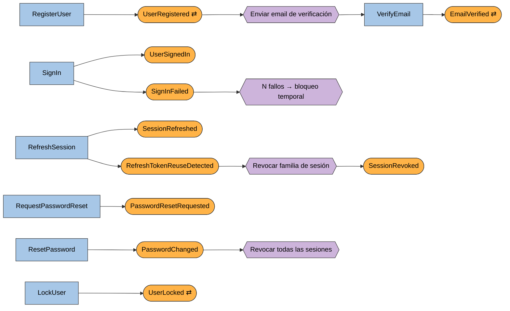
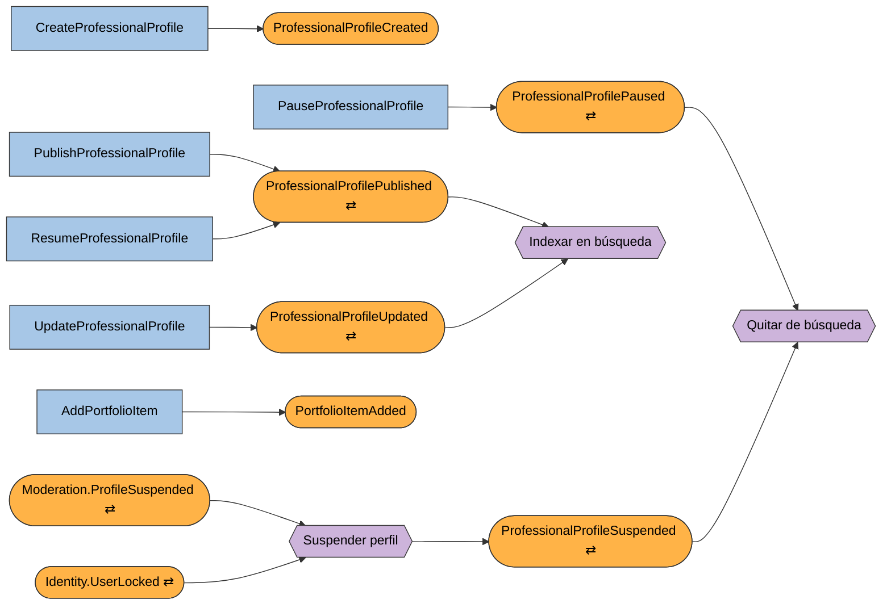
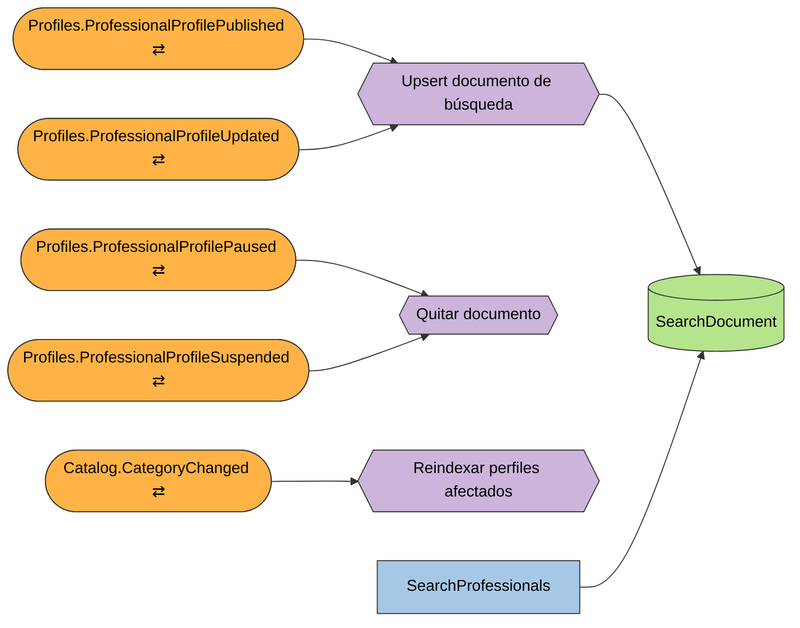
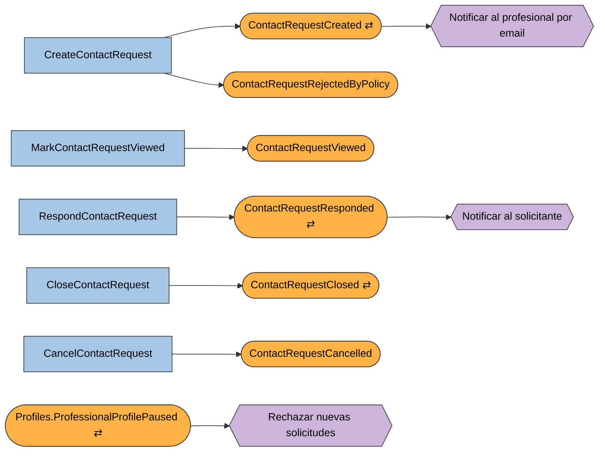
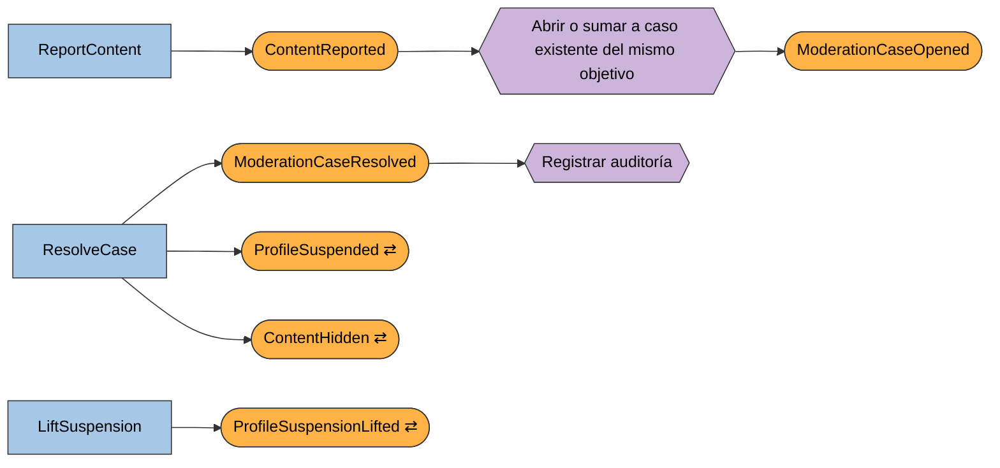

# Event Storming inicial

Etapa 0 (AGENTS.md §28, punto 5). Nivel "big picture" + process level de los flujos MVP.

Convención:
- **Comando** (azul): intención, imperativo. `RegisterUser`.
- **Evento** (naranja): hecho pasado. `UserRegistered`.
- **Política** (lila): "cuando X, entonces Y".
- **Read model** (verde): lo que alguien mira para decidir.
- Prefijo de módulo en eventos de integración: `Identity.UserRegistered`.

Eventos **de dominio** quedan dentro del módulo. Eventos **de integración** cruzan módulos y forman parte del contrato público (ver `BOUNDED-CONTEXTS.md`). Marcados con ⇄.

## 1. Identidad

## 2. Perfil profesional

Read models: "Mi perfil profesional" (borrador con checklist de requisitos faltantes), "Perfil público".

## 3. Búsqueda

Búsqueda es solo lectura: no emite eventos de dominio. Consume eventos para mantener su índice.

## 4. Contacto

`ContactRequestRejectedByPolicy` cubre: destinatario pausado o suspendido, duplicado abierto, límite diario superado, solicitante bloqueado.

## 5. Favoritos

`AddFavorite` → `FavoriteAdded`; `RemoveFavorite` → `FavoriteRemoved`. Política: cuando `Profiles.ProfessionalProfileSuspended`, el favorito se mantiene pero la card muestra "no disponible".

## 6. Moderación

## 7. Puntos calientes (hotspots)

| # | Hotspot | Dónde se resuelve |
|---|---|---|
| H1 | ¿Qué "interacción elegible" habilita una valoración? | D14, fuera del MVP |
| H2 | ¿Un visitante sin cuenta puede enviar solicitud interna? | D15: no; usa canales públicos |
| H3 | ¿Qué pasa con solicitudes `Pending` cuando el perfil se pausa? | BR-067: se mantienen; el profesional puede responderlas |
| H4 | Interpretación de consulta natural sin IA | BR-050, `ARCHITECTURE.md` §Búsqueda |
| H5 | Spam de solicitudes en una plataforma gratuita | BR-063..065, `SECURITY.md` |
| H6 | Suspensión por moderación vs pausa voluntaria | Estados separados; BR-028 |
